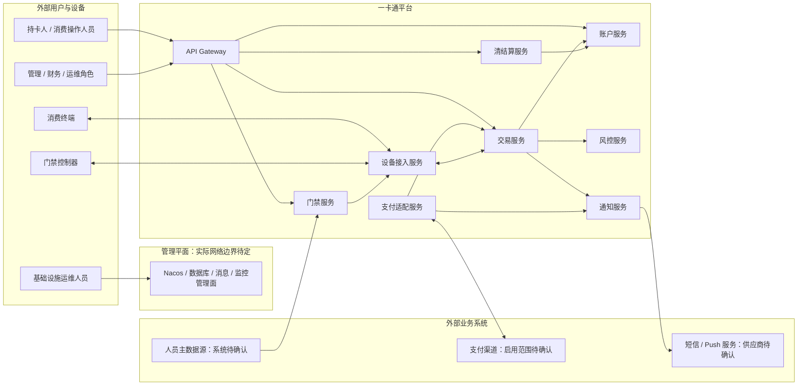

# Architecture Map

## System Context



此图表达目标业务上下文和调用责任，不表示现有 Gateway 路由已安全开放，也不表示外部系统、身份方式或接口契约已选定。支付回调方向/协议、人员主数据来源、通知供应商和设备接入网络仍待阶段 0 确认；当前风险/设备 Gateway 路由与安全缺口见 [`阶段0-安全与数据边界初稿.md`](阶段0-安全与数据边界初稿.md)。

`docs/微服务划分.md` defines the eight business boundaries. The root Maven
project aggregates `common`, `gateway`, the service modules, and their public
contracts under `apis/`.

```text
user/admin clients -> gateway -> allowlisted user/admin APIs
payment channels -> signed callback ingress -> payment-adapter (ingress path TBD)
terminal controllers -> device-service (authenticated protocol ingress)

transaction -> account-api, risk-api, payment-adapter-api
payment-adapter -> transaction-api (callback contract; HTTP vs durable event TBD)
clearing -> account-api (settlement through the account contract)
access -> device-api (snapshot delivery)
transaction/payment -> notification event (broker/outbox contract TBD)
person directory -> access (master-data contract TBD)
all services -> common
```

The transaction service orchestrates funds changes through service contracts;
only account service owns account balance writes. Terminals use this online
transaction path by default. Terminal-local payment is a bounded failover for
an unexpected connectivity loss, with detection thresholds and the recovery
barrier defined in stage 0 of `docs/开发阶段规划.md`. Access policy snapshots and
device delivery remain separate concerns. Monitoring is composed only from
`deploy/monitoring/`.

The current skeleton POMs include `transaction -> account/risk` and
`access -> device` API dependencies. Payment callbacks and clearing settlement
still need contracts and implementation. Gateway now validates OIDC JWTs,
applies a development path/method/role allowlist, strips untrusted identity
headers, and keeps Actuator on a separate management port. The route matrix is
development scaffolding; production exposure, shared rate limits, signed
payment callbacks, and service-to-service identity remain gated. See
`docs/阶段1-Gateway入口白名单.md` and `docs/阶段0-安全与数据边界初稿.md`.
Device protocol ingress has separate authentication and network requirements
from user APIs.

Service modules currently provide runnable Spring Boot and Actuator skeletons.
Domain endpoints, schemas, and external provider integrations are added when
their contracts are defined; this architecture scaffold does not invent them.
The implementation order and per-stage verification gates are documented in
`docs/开发阶段规划.md`.
